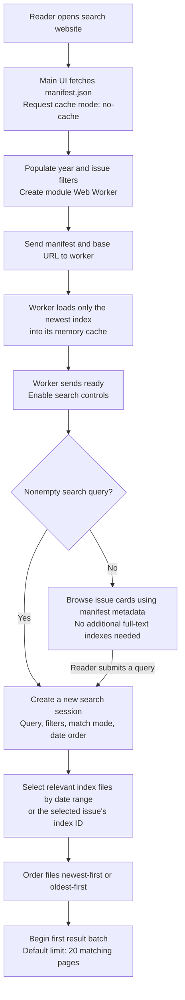
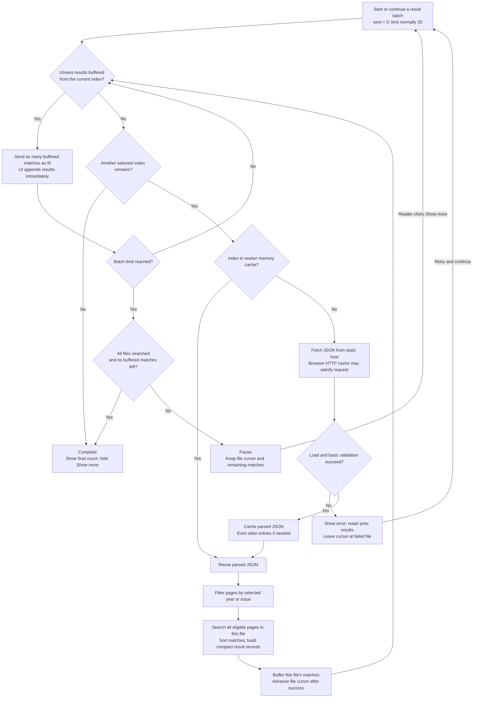
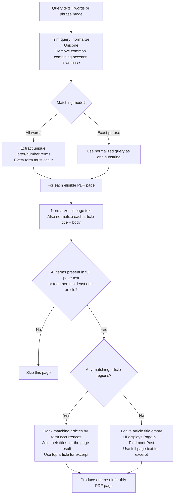

# How client-side archive search works

The browser downloads static JSON files and searches their text locally. GitHub Pages serves files; it does not run a search query or database. The indexing job has already extracted PDF text, detected article headings, and organized the data before a reader opens the website.

This document describes the implementation in the sibling `piedmontpost` repository as inspected on **October 28, 2026**. It covers the current algorithm, including its limits, rather than a proposed replacement.

## Components

| File | Responsibility |
|---|---|
| `manifest.json` | Lists issues and index files, dates, file sizes, issue/page counts, and search settings. It contains catalogue metadata, not full page text. |
| `indexes/*.json` | Contains searchable page text and precomputed article titles/text. A file can cover a quarter or an individual issue. |
| `app.js` | Handles the form, filters, browsing, result rendering, URL parameters, and messages to/from the worker. |
| `search-worker.js` | Runs searches away from the UI thread, fetches index files, and handles search/more/stop messages. |
| `progressive-search.js` | Implements the index memory cache and the resumable search session. |
| `search.js` | Normalizes text, matches pages/articles, selects result titles, sorts matches, and creates excerpts. |
| `pdf-links.js` | Builds links to the original PDF with the page number. |

## Loading the page and starting a search



Startup always preloads the newest index, even if the reader later selects an old year. The application uses the same cache for subsequent queries. Opening a shared URL such as `?q=Misha%20Edel` automatically starts that search once the worker is ready.

With an empty query, the page browses issues instead of scanning text. Issue cards are shown in groups of 12 using dates, page counts and PDF URLs from the manifest.

## Progressive search: one index file at a time



The pause is based on a **result count**, not the physical screen height. A search scans an entire loaded file before returning its matches; it does not stop halfway through the file after finding the twentieth hit. Remaining matches from that file are buffered for the next batch.

Results stream **between files**. If one file has three matches, those three can appear while the worker continues into older files to fill the batch. A rare term can require scanning the entire selected archive before finding 20 matches—or before concluding there are no more.

### Example: 27 matches in the newest file

These counts are illustrative:

| Reader action | What the session does | Visible results | Buffered for later |
|---|---|---:|---:|
| Search | Searches the already-preloaded newest file, which has 27 matching pages. Sends 20 and pauses. | 20 | 7 from the newest file |
| Show more | Sends the buffered 7, then searches the next file. If that file has 20 matches, sends 13 of them. | 40 | 7 from the second file |
| Show more again | Starts with those 7 before requesting another file. | At least 47 if allowed to continue | Depends on later matches |

A new batch does not restart the search from the newest file. Each session preserves:

- `cursor`: the next selected file that has not yet been successfully searched.
- `pending`: compact matches from the most recently searched file.
- `offset`: how many of those matches have already been sent.
- `delivered`: total result pages sent to the UI so far.

The session is complete only when all selected files have been processed **and** every buffered match has been delivered.

## How a page matches a query



### Matching details

- Matching is case-insensitive and uses Unicode compatibility normalization (`NFKD`). It strips combining characters in the U+0300–U+036F range, making common accented names easier to find.
- **All words** mode extracts letter/number sequences, removes repeated query terms, and requires every term. Terms may appear in any order and need not be adjacent. This is substring matching, not whole-word matching: `post` also matches `postcard`.
- **Exact phrase** mode searches for the normalized query as one contiguous substring. The browser trims outer whitespace but does not collapse repeated internal spaces or remove punctuation from a phrase. PDF text was cleaned separately during indexing.
- There is no fuzzy spelling, stemming, semantic matching, or server-side search engine in this algorithm.
- A page can match through its full text even when no individual article contains all terms. For example, a name in a contributor list can produce a valid page result without an article headline.

### Page results, article titles and excerpts

The unit of a result is a **PDF page**, not an individual article. Several occurrences on the same page still yield one result. If multiple detected articles on that page match, their titles are joined with ` · `. The article with the highest combined term-occurrence count supplies the excerpt.

When no article region matches, the UI falls back to `Page 2 · Piedmont Post`, for example. This is intentional for contributors, publication information, and other text that is searchable but not reliably assigned to an article. Article boundaries and headings were inferred during indexing; the browser does not infer them again or open the PDF to verify them.

An excerpt is built around the earliest occurrence of any query term in the chosen text: approximately 90 characters of preceding context and up to 330 characters total, with ellipses when clipped. The UI then highlights matching text in the heading/excerpt. Matching removes accents, but the current highlighting regex is case-insensitive rather than accent-normalized, so a successful accent-insensitive match may not receive identical highlighting.

## Ordering and progress counts

The website offers **newest first** and **oldest first**. It orders index descriptors by their latest or oldest issue date, then sorts matching pages inside each file by date and page number. The current weekly/quarterly partition normally keeps these ranges sequential.

Although `search.js` can calculate a simple occurrence score and supports a relevance sort when called directly, the progressive UI passes a date order. It does **not** promise global relevance ranking before the complete archive has been searched.

Until completion, the result count says **found so far**. At a pause it means “these pages have been delivered,” not “these are all matches in the archive.” The progress message identifies the date range currently being processed.

## Two different browser caches

| Cache | What it holds | Behavior |
|---|---|---|
| Worker memory cache | Already-parsed index JSON | Shared across searches within the worker lifetime. The latest index is pinned; older entries are evicted using least-recently-used order. |
| Browser HTTP cache | Downloaded responses | Index requests use `cache: 'force-cache'`, allowing reuse when the browser can satisfy the request. Actual retention depends on the browser and response headers. |

The worker cache targets at most four files and 16 MiB by default. The byte budget uses **raw JSON file sizes**, not actual JavaScript heap usage. The latest file and the file just loaded are protected during eviction, so those files can exceed the byte target if necessary. Parsed data and buffered results require additional memory.

Content-hashed index filenames allow unchanged files to keep the same URL across publications. The manifest is requested with `cache: 'no-cache'`, which asks the browser to revalidate rather than simply trusting a cached catalogue. This is different from `no-store`.

After fetching an index, the worker checks its version, ID, page-array presence and page count. The browser does **not** recompute the manifest's SHA-256 hash; full content verification happens in the offline publication pipeline.

## New queries, Stop and failures

A new query or filter selection gets a new request ID and a new search session. The UI clears the previous results, sends a stop message for the previous job, and ignores stale responses carrying an older ID. The worker retains its index memory cache, allowing the new session to reuse parsed files.

**Stop** asks the worker to abort the active job. An outstanding fetch can be aborted; the session retains its cursor and buffered results for **Continue search**. This is cooperative cancellation: the worker's synchronous scan of an individual file must yield before it can handle a newly arriving stop message. It does not interrupt every term comparison instantly, while the main UI remains on its separate thread.

A download/load failure leaves the file cursor unchanged. **Retry and continue** attempts the same file instead of silently skipping its date range, and previously rendered results remain visible. Initialization failures have a separate retry that reloads the manifest and starts a fresh worker.

Repeated words do not duplicate a page result. Separate indexed PDFs can still produce separate results, even if they contain similar text: the browser has no general cross-PDF deduplication stage. Superseded archive URLs are managed by the indexer.

## Opening the PDF

The main UI builds a link from the result's original source URL, preserves its existing query parameters, and adds `?page=N` plus `#page=N`. Links open in a new tab. Whether the viewer navigates to that page depends on the PDF viewer; search itself does not download or render PDF pages.

## Observing the algorithm

Open browser developer tools and filter console messages by **`[Archive search]`**, with Info messages enabled. The temporary logging reports manifest loading, index fetches, memory-cache hits/evictions, pages searched, matches found, results emitted/displayed, pauses, continuation, errors, and stale responses.

To follow a typical search, look for:

```text
Manifest ready
Worker initializing; preload latest index only
Index ready
Worker ready
Search session created
Index cache hit
Index searched
Results emitted
Search paused at result limit
Continue requested
```

The precise messages depend on whether a query was supplied initially, whether files were cached, and whether the search fills a batch.

For the separate indexing/deployment system, see [SYSTEM-FLOW.md](SYSTEM-FLOW.md). For the scheduled workflow's YAML, see [WORKFLOW-EXPLAINED.md](WORKFLOW-EXPLAINED.md).
