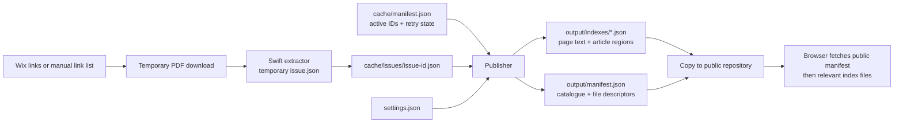

# Data files: formats, schemas and contents

This is a descriptive schema reference for the implementation inspected on **October 29, 2026**. The tables describe the fields produced and consumed by the current programs; they are not a separate JSON Schema validator. Existing validation checks are described near the end.

All text data below uses ordinary **UTF-8 JSON**. A compact file may occupy one long line, but it is one JSON document—not JSON Lines/NDJSON. JSON object-key order is not semantically significant; exact serialized bytes do matter when calculating a published file’s hash.

## Where each file belongs

| File / directory | Repository or location | Tracked in Git? | Purpose / reader |
|---|---|---|---|
| `settings.json` | Indexing repository | Yes | Search batch/memory settings consumed by the publisher. |
| `cache/manifest.json` | Indexing repository | Yes | Active source URLs, cache identities, successful extraction times and failed-refresh flags. Read by the indexer and publisher. |
| `cache/issues/<issue-id>.json` | Indexing repository | Yes | One successfully extracted PDF’s issue metadata, full page text and detected articles. |
| `cache/discovered-links.json` | Indexing repository | No | Latest discovered link list for inspection; can also inform a manual link-list file. |
| `cache/indexer.lock` | Indexing repository, while a job runs | No | Prevents two local indexing processes from modifying the same cache. |
| `cache/pdf-indexer` | Indexing repository | No | Compiled macOS Swift executable; regenerated when necessary. |
| `cache/swift-cache/` | Indexing repository | No | Compiler module cache, not newspaper text. |
| `output/manifest.json` | Indexing repository | No | Generated browser catalogue, ready to copy to the website. |
| `output/indexes/<index-id>.<content-hash>.json` | Indexing repository | No | Generated searchable data grouped by quarter or weekly issue. |
| `manifest.json` and `indexes/*.json` | Public `piedmontpost` repository root | Yes | Published copies of the generated data. Read by the browser. |
| Temporary `issue.pdf` and `issue.json` | OS temporary directory during extraction | No | Downloaded PDF and extractor output; removed by the Node wrapper after the attempt. |
| `package.json` / `package-lock.json` | Indexing repository | Yes | npm scripts/dependencies and reproducible dependency versions, not newspaper data. |

Only JSON indexes are published. `.json.gz` and `.json.br` sidecars have been removed; publication cleans up legacy copies. Original PDFs remain on Wix. The public site contains no archive password, browser cookies, compiler cache or per-issue maintenance manifest.

The default output directory is `output/`, overridable with `SEARCH_OUTPUT_DIR`. `SEARCH_SITE_DIR` selects the website checkout, defaulting to the sibling `../piedmontpost`. The archive CLI additionally accepts `--cache-dir` and `--output-dir`. These flags do not automatically configure later commands: standalone `publish:indexes` and `verify:indexes` read the repository’s default `cache/`, while `SEARCH_OUTPUT_DIR` controls their generated-data location. The usual workflow uses the default cache throughout.

## The data pipeline



## Common types and identity rules

| Type / convention | Meaning |
|---|---|
| Issue date | `YYYY-MM-DD`, the newspaper issue date rather than its download/publication timestamp. |
| Timestamp | ISO 8601 timestamp, normally UTC with a `Z` suffix. |
| Page number | Positive, **1-based PDF page position**. It is not a guarantee about the printed page label. |
| `sourceUrl` | Original HTTP(S) PDF URL on the source website. |
| `file` | Legacy-compatible alias for the same source URL in this version; it is not a path to a local PDF. |
| `articles` | Optional array of inferred article regions for one page. Not a complete article database or cross-page story model. |
| SHA-256 | Lowercase, 64-character hexadecimal digest. Different hashes below identify different things. |

### Two hashes with different jobs

**Issue identity:** SHA-256 of `URL.origin + decoded URL.pathname`. Query strings and fragments are ignored. It identifies a source URL path, not the PDF’s content. It is used as the cache filename, published issue `id`, and page `issueId`. A new Wix URL produces a different ID even if its PDF is identical. Changing the PDF at the same path does not automatically invalidate an otherwise successful cache entry; `--rebuild` explicitly refreshes it.

**Published content hash:** SHA-256 of the generated index file’s complete UTF-8 bytes, including its trailing newline. The first **16 hex characters** appear in its filename. The complete digest appears in its manifest descriptor. It changes when that grouped index’s serialized data changes.

A weekly index ID is `<date>-<first 8 characters of issue identity>`. A quarterly ID is `YYYY-QN`. A page’s unique publication key is the pair `(issueId, page)`. Articles have no separate persistent IDs.

All examples below are **synthetic**, using `example.org`; their IDs and content hash are internally calculated. The displayed index JSON is pretty-printed for reading. Its descriptor’s byte count/hash refer to the compact serialized form plus newline, not the indented display.

## 1. `settings.json`

```json
{
  "batchSize": 20,
  "memoryCacheBytes": 16777216
}
```

| Field | Type | Meaning |
|---|---|---|
| `batchSize` | Positive integer in intended configuration | Matching PDF pages delivered per search batch. Current setting: 20. Publisher/worker fall back to 20 for a missing/falsy value. |
| `memoryCacheBytes` | Positive integer in intended configuration | Target raw-JSON byte budget for the browser’s parsed-index cache. Current setting: 16 MiB. It is not a measurement of the JavaScript heap. |

There is no configured `quarterThrough`. The publisher computes the last completed calendar quarter in America/Los_Angeles. The calculated date appears in the public manifest as output metadata. These settings have no `version` property, and the current code is not a comprehensive settings-schema validator.

## 2. `cache/manifest.json`: extraction state

```json
{
  "version": 1,
  "entries": {
    "6d0fbc4b17a91b005cf4ecc40594bcf2968965f4428a3ce3648b2a3752c5ca11": {
      "sourceUrl": "https://example.org/issues/2026-10-21.pdf",
      "label": "October 21, 2026",
      "date": "2026-10-21",
      "etag": "\"example-etag\"",
      "indexedAt": "2026-10-29T18:00:00.000Z"
    }
  }
}
```

| Field | Type | Meaning |
|---|---|---|
| `version` | Integer, currently `1` | Cache-manifest format version. The indexer rejects unsupported versions. |
| `entries` | Object keyed by full issue ID | Active issues to include when assembling the archive. |
| `entries[id].sourceUrl` | String | Current PDF source URL. It can be updated when only query parameters change. |
| `entries[id].label` | String | Discovered label, usually `October 21, 2026`; an unlabeled explicit URL may produce an empty string. |
| `entries[id].date` | Date string | Successfully extracted issue date. |
| `entries[id].etag` | String or `null` | ETag captured from the successful download, when supplied by the host. **Recorded only:** the current incremental skip rule does not perform an ETag request or a conditional GET. |
| `entries[id].indexedAt` | Timestamp string | Last successful extraction time. Normal cache reuse does not update it. |
| `entries[id].refreshFailure` | Optional object | A previously cached issue failed to refresh and must be retried. |
| `refreshFailure.failedAt` | Timestamp string | Time the failed refresh was recorded. |
| `refreshFailure.message` | String | Diagnostic description of the failed download/extraction. |

A failed-refresh field has this shape:

```json
{
  "refreshFailure": {
    "failedAt": "2026-10-29T18:10:00.000Z",
    "message": "Timeout exceeded"
  }
}
```

This last example shows only the optional field, not a complete manifest.

A normal run skips an issue only when its manifest entry and usable issue JSON exist, `--rebuild` is off, and no `refreshFailure` is recorded. A failed rebuild preserves the old issue JSON and marks the manifest entry; a successful extraction replaces the entry and clears the flag. A failed brand-new issue has no successful cache entry and is retried because it remains absent.

The active manifest, not a directory listing, controls publication. An old per-issue JSON may remain on disk after its URL is retired. It is not published unless its ID remains in `entries`. A successfully indexed current dated link can retire an unlisted URL for the same date; two PDFs still explicitly listed for that date remain separate.

## 3. `cache/issues/<issue-id>.json`: one PDF

```json
{
  "issue": {
    "date": "2026-10-21",
    "file": "https://example.org/issues/2026-10-21.pdf",
    "pages": 1,
    "sourceUrl": "https://example.org/issues/2026-10-21.pdf"
  },
  "pages": [
    {
      "date": "2026-10-21",
      "file": "https://example.org/issues/2026-10-21.pdf",
      "page": 1,
      "sourceUrl": "https://example.org/issues/2026-10-21.pdf",
      "text": "Council approves library improvements The council approved new library improvements after reviewing the community proposal and hearing comments from local residents. Executive Editor: Example Editor",
      "articles": [
        {
          "title": "Council approves library improvements",
          "text": "The council approved new library improvements after reviewing the community proposal and hearing comments from local residents.",
          "source": "detected"
        }
      ]
    }
  ]
}
```

| Field | Type | Meaning |
|---|---|---|
| `issue` | Object | Metadata describing this PDF. |
| `issue.date` | Date string | Issue date repeated on the page records. |
| `issue.file`, `issue.sourceUrl` | URL strings | Source URL aliases. Publication refreshes them from the cache manifest. |
| `issue.pages` | Positive integer | Expected PDF page count. Note that this is a number, unlike the outer `pages` array. |
| `pages` | Array of page objects | One record for each PDF page, in page-number order. |
| `pages[].date` | Date string | Parent issue date. |
| `pages[].file`, `pages[].sourceUrl` | URL strings | Source URL aliases. |
| `pages[].page` | Positive integer | 1-based page position; records must cover `1` through the issue page count. |
| `pages[].text` | String | Cleaned full page text, including searchable text not attached to any article. May be empty on a blank/image-only page. |
| `pages[].articles` | Optional array | Detected article regions. The extractor omits it if none survive detection. |
| `articles[].title` | String | Detected main heading; can join multiple heading lines. |
| `articles[].text` | String | Inferred article body, prefixed by a subtitle/deck if detected. |
| `articles[].source` | String, currently `detected` | Tells the UI these are inferred headlines. The current extractor does not create manually reviewed article records. |

There is no root `version` property in a per-issue cache document. Its structure is checked by the Node wrapper. It contains no saved line coordinates, font sizes, confidence score, dedicated subtitle field, images, or PDF bytes. Layout information exists only while Swift is running.

The full page text and article text overlap intentionally. The full text preserves coverage; article regions help display a useful title and excerpt. A result remains page-based, including when several article regions match. `articles[].text` does not necessarily reconstruct a complete story spanning pages.

## 4. Discovery and explicit link-list files

`cache/discovered-links.json` is the latest discovery snapshot. Its usual shape is:

```json
[
  {
    "url": "https://example.org/issues/2026-10-21.pdf",
    "label": "October 21, 2026"
  }
]
```

A manually supplied `--links FILE` accepts a nonempty JSON array containing URL strings, link objects, or a mixture:

```json
[
  "https://example.org/issues/2026-10-21.pdf",
  {
    "url": "https://example.org/issues/2026-10-28.pdf",
    "label": "October 28, 2026",
    "date": "2026-10-28"
  }
]
```

| Link field | Type | Meaning |
|---|---|---|
| `url` | Required HTTP(S) URL string for an object entry | PDF download location. URLs with embedded credentials are rejected. |
| `label` | Optional string | Helps identify weekly issues and infer dates. Program/parade labels are filtered out. |
| `date` | Optional valid date string | Explicit issue-date hint; otherwise date inference uses the label, URL or PDF cover. |
| `key` | Internal derived string | Added by URL deduplication; callers do not need to supply it. |

Discovery can contain non-issue links that are later ignored. A discovered link does not prove a successful extraction, and this file is not an alternative to the persistent cache manifest. No password or browser cookies are saved here. `--links` mode uses direct HTTP downloads rather than the logged-in Playwright context; URLs in that file must be accessible in that mode.

## 5. Published `indexes/*.json`: searchable content

```json
{
  "version": 1,
  "id": "2026-10-21-6d0fbc4b",
  "issues": [
    {
      "date": "2026-10-21",
      "file": "https://example.org/issues/2026-10-21.pdf",
      "pages": 1,
      "sourceUrl": "https://example.org/issues/2026-10-21.pdf",
      "id": "6d0fbc4b17a91b005cf4ecc40594bcf2968965f4428a3ce3648b2a3752c5ca11",
      "indexId": "2026-10-21-6d0fbc4b"
    }
  ],
  "pages": [
    {
      "date": "2026-10-21",
      "file": "https://example.org/issues/2026-10-21.pdf",
      "page": 1,
      "sourceUrl": "https://example.org/issues/2026-10-21.pdf",
      "text": "Council approves library improvements The council approved new library improvements after reviewing the community proposal and hearing comments from local residents. Executive Editor: Example Editor",
      "articles": [
        {
          "title": "Council approves library improvements",
          "text": "The council approved new library improvements after reviewing the community proposal and hearing comments from local residents.",
          "source": "detected"
        }
      ],
      "issueId": "6d0fbc4b17a91b005cf4ecc40594bcf2968965f4428a3ce3648b2a3752c5ca11"
    }
  ]
}
```

| Root field | Type | Meaning |
|---|---|---|
| `version` | Integer, currently `1` | Published index format version. |
| `id` | String | Index group ID, matching the descriptor in the public manifest. |
| `issues` | Array | Metadata for issues included in this group. A weekly group has one issue; a quarterly group may have many. |
| `pages` | Array | Searchable page records for those issues. |

Published issues have the same fields as cached `issue`, plus:

| Added issue field | Type | Meaning |
|---|---|---|
| `id` | Full issue-ID string | URL-derived identity. |
| `indexId` | String | Group containing this issue. |

Published pages have the same fields as cached page records, plus:

| Added page field | Type | Meaning |
|---|---|---|
| `issueId` | Full issue-ID string | Links the page to its entry in `issues`. |

An example filename corresponding to the synthetic data above is:

```text
indexes/2026-10-21-6d0fbc4b.5f99a5ea4074aa48.json
```

Issues are sorted newest date first, then by issue ID. Pages are sorted newest date first, then issue ID, then ascending page number. Browser sessions can reorder matches for oldest-first searching.

Each issue appears in exactly one group in the current manifest. Historical JSON generations can remain in `indexes/` for existing browser tabs; their presence does not make them part of a new search. The browser follows the manifest rather than scanning the directory.

## 6. Public `manifest.json`: catalogue and lookup table

```json
{
  "version": 1,
  "generatedAt": "2026-10-29T18:00:00.000Z",
  "source": "https://www.piedmont-post.com/archive",
  "quarterThrough": "2026-09-30",
  "batchSize": 20,
  "memoryCacheBytes": 16777216,
  "issueCount": 1,
  "pageCount": 1,
  "indexes": [
    {
      "id": "2026-10-21-6d0fbc4b",
      "kind": "weekly",
      "url": "indexes/2026-10-21-6d0fbc4b.5f99a5ea4074aa48.json",
      "from": "2026-10-21",
      "to": "2026-10-21",
      "latestIssue": "2026-10-21",
      "oldestIssue": "2026-10-21",
      "issueCount": 1,
      "pageCount": 1,
      "bytes": 948,
      "sha256": "5f99a5ea4074aa484b09d3661583b239893af0f865a9836cd5a376ff72c500e9"
    }
  ],
  "issues": [
    {
      "date": "2026-10-21",
      "file": "https://example.org/issues/2026-10-21.pdf",
      "pages": 1,
      "sourceUrl": "https://example.org/issues/2026-10-21.pdf",
      "id": "6d0fbc4b17a91b005cf4ecc40594bcf2968965f4428a3ce3648b2a3752c5ca11",
      "indexId": "2026-10-21-6d0fbc4b"
    }
  ]
}
```

| Root field | Type | Meaning |
|---|---|---|
| `version` | Integer, currently `1` | Public manifest format version. |
| `generatedAt` | Timestamp string | Time this manifest content was generated. Preserved on an unchanged publication, so it is **not** a “last checked Wix” heartbeat. |
| `source` | URL string | Archive landing-page URL, not an individual PDF URL. |
| `quarterThrough` | Date string | **Computed** last completed quarter end. Not a configurable setting. |
| `batchSize` | Integer | Browser result-batch size. |
| `memoryCacheBytes` | Integer | Browser memory-cache raw-byte target. |
| `issueCount` | Integer | Number of active, unique issues in this publication. |
| `pageCount` | Integer | Total published page records. |
| `indexes` | Array of descriptors | Files the browser can search, newest issue date first. |
| `issues` | Array of published issue metadata | Browse/filter catalogue. Contains no full page or article text. |

Each `indexes[]` descriptor contains:

| Field | Type | Meaning |
|---|---|---|
| `id` | String | Group identity, e.g. `2026-Q3` or a weekly date plus issue-ID prefix. |
| `kind` | `quarterly` or `weekly` | Grouping strategy. |
| `url` | Relative path string | Index file location, resolved relative to the search website. |
| `from`, `to` | Date strings | Full quarter bounds for quarterly groups; issue date for weekly groups. Used to skip unrelated files. |
| `latestIssue`, `oldestIssue` | Date strings | Actual newest/oldest included issue dates; may be inside the quarter boundaries. |
| `issueCount`, `pageCount` | Integers | Counts within this file. |
| `bytes` | Integer | Exact uncompressed UTF-8 JSON byte count, including trailing newline. Used for verification and browser cache accounting. |
| `sha256` | Full digest string | Exact published index-byte hash. Verified by offline scripts; the browser currently checks structure/counts, not this digest. |

`gzipBytes` and `brotliBytes` are no longer produced or needed. Weekly/quarterly group IDs identify logical groups; the content-hashed filename identifies one immutable generation of that group.

The public manifest is written/copied **after** its referenced JSON files exist. The sync program validates each source file’s byte count and hash and refuses to overwrite an existing content-addressed JSON path with different bytes.

## 7. Operational files and in-memory values

The lock file temporarily contains an object like:

```json
{
  "pid": 12345,
  "startedAt": "2026-10-29T18:00:00.000Z"
}
```

`pid` identifies the local process, and `startedAt` is diagnostic. An exclusive filesystem create enforces the lock; there is no automatic age-based expiration. Normal completion removes it. Investigate a leftover lock before removing it if another indexing process might still be running.

`cache/pdf-indexer` is a binary, not JSON. `cache/swift-cache/` contains compiler artifacts whose paths/toolchain can become invalid after a move or upgrade. Neither contains the authoritative newspaper extraction cache.

The programs also construct temporary **in-memory objects**, not extra authoritative files:

| Value | Typical fields / purpose |
|---|---|
| Combined archive | `source`, `issues`, `pages`; the sync path also supplies `updatedAt`. Used to assemble published groups. |
| Run statistics | `discovered`, `added`, `reprocessed`, `skipped`, `ignored`, `failed`; logged to the console. |
| Failure list | `{label, message}` records for the run. Cached refresh failures are also saved on the existing manifest entry. |
| Worker result | `date`, `page`, `sourceUrl`, `title`, `titleSource`, `terms`, `excerpt`; compact browser message, not the stored index schema. |

Browser match scores and highlighted HTML are generated at query time. They are not stored in the JSON indexes.

## What validation actually checks

- `validIssue()` in `index-archive.mjs` checks issue-date shape, a positive issue page count, the page-array length, sequential 1-based page numbers, and string page text. It is not a complete type validator for every optional field.
- `publish-indexes.mjs` checks issue/page relationships, duplicate issues/pages, complete per-issue page numbering and immutable JSON collisions. It calculates the content hashes and descriptors.
- `verify-indexes.mjs` compares every published page’s date, number, text, article data and source URL with the active cache. It checks file hashes/byte counts, counts, dates, issue references and duplicate protection.
- `sync-site.mjs` validates referenced paths and content hashes/lengths before copying; it copies the manifest last and preserves previous JSON generations.
- The browser validates enough structure to reject unsupported/incomplete files, but does not repeat the entire offline verification procedure.

The root `version: 1` fields belong to separate formats: a cache manifest is not interchangeable with a public manifest or an index chunk just because their version numbers match.

## Which file to keep or rebuild

Keep the **cache manifest and active per-issue JSON** in Git. Regenerate `output/` from them with `npm run publish:indexes`; this does not reopen PDFs. Regenerate extracted text/article regions with `index:archive --rebuild` when PDF parsing changes. Republish with `npm run publish:site` after verification.

A fresh Git checkout can have a public manifest newer than its ignored local `output/`. That is normal: generated output is not synchronized by Git and should be regenerated before testing/publishing a new build.

Do not hand-edit content-hashed public files. Change the parser/source cache as appropriate and regenerate; changing the bytes requires a new content hash and manifest descriptor.

See [PDF-PARSING.md](PDF-PARSING.md) for extraction, [CLIENT-SEARCH.md](CLIENT-SEARCH.md) for browser matching, and [AUTOMATION.md](AUTOMATION.md) for scheduled publication.
