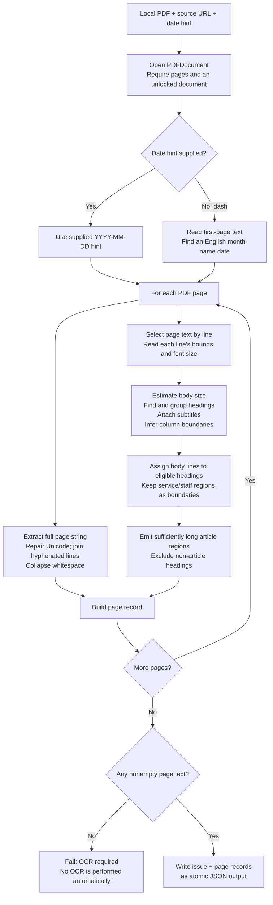
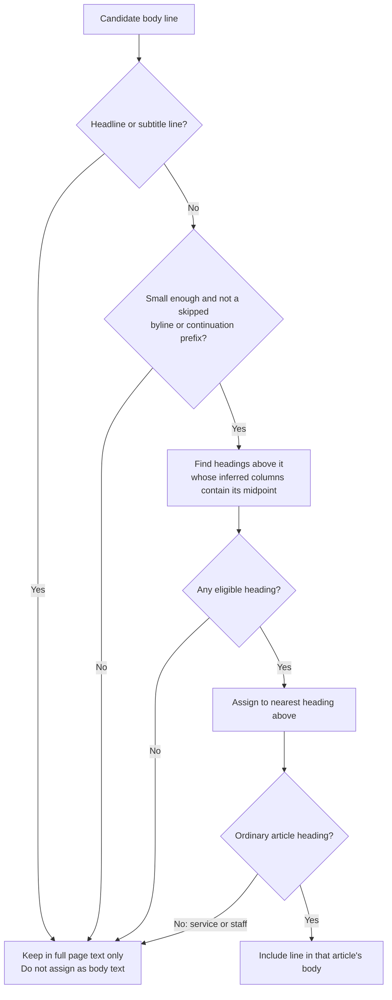

# How the PDF parsing program works

The parser is [`scripts/index-pdfs.swift`](scripts/index-pdfs.swift). It opens **one local newspaper PDF** and produces an issue-level JSON document containing full page text plus inferred article headings and bodies. It runs during offline indexing; readers’ browsers never execute Swift or parse the PDFs to perform a search.

This guide describes the code inspected on **October 29, 2026**, including subtitle grouping and non-article layout boundaries. The article segmentation is a collection of layout heuristics, not an AI model or a guaranteed reconstruction of the printed articles.

## Responsibilities: Swift versus Node

| Swift extractor | Node indexing wrapper |
|---|---|
| Open and validate the local PDF. | Discover source links and log into Wix. |
| Use the supplied date or infer one from the first page. | Infer/validate link-date hints before invoking Swift. |
| Extract and clean page text. | Download PDFs with timeout/retry handling. |
| Inspect line geometry and font sizes. | Compile/reuse the Swift executable. |
| Infer headings, subtitles and article regions. | Validate extractor JSON and commit successful cache entries. |
| Serialize one issue as JSON. | Maintain retry state, group indexes, verify and publish. |

The Swift program does not know about GitHub Actions, credentials, quarterly grouping, Git pushes or browser search queries. It does not download URLs: the source URL argument is metadata copied into its output.

## Invocation and output

The ordinary path is through the Node wrapper:

```sh
npm run index:archive -- --browser-channel chrome
```

For an isolated test, compile and run the Swift program directly:

```sh
mkdir -p cache/swift-cache
swiftc -module-cache-path "$PWD/cache/swift-cache" \
  scripts/index-pdfs.swift -o cache/pdf-indexer

cache/pdf-indexer --extract-one \
  "10-21-26 Post v2 - Web.pdf" \
  /tmp/oct21-extracted.json \
  "https://example.org/original-issue.pdf" \
  2026-10-21
```

The example source URL is deliberately a placeholder. Use the real URL if the output will be used as production data. This command writes a temporary test JSON file; it does **not** update `cache/manifest.json`, the committed per-issue cache, or the public indexes.

| Argument | Meaning |
|---|---|
| `--extract-one` | Select the only supported extraction mode. |
| Input path | Local PDF file already downloaded or provided for testing. |
| Output path | JSON file to write. Its parent directory must exist. |
| Source URL | Original PDF URL stored in issue/page metadata. |
| Date or `-` | Issue date hint, or a dash to infer the date from the cover. |

On success it prints `Extracted N pages` and exits with status 0. Errors are written to stderr with `Extraction failed:` and exit status 1. An unsupported/missing invocation prints a usage message and exits 1.

The output structure is:

```text
issue
  date, file, sourceUrl, pages (page count)
pages[]
  date, file, sourceUrl, page (1-based number), text
  articles[] (optional)
    title, text, source: "detected"
```

See [DATA-FILES.md](DATA-FILES.md) for field-level schemas and complete JSON examples.

## Overall parsing flow



## 1. PDF loading and issue date

The command opens a `PDFDocument` from the input file URL. It rejects a document that cannot be opened, has no pages, or is locked. The current error message groups these cases as invalid, empty or encrypted; it does not attempt a password unlock.

If a date hint was supplied, Swift checks that its shape is `YYYY-MM-DD`. The Node wrapper additionally validates an explicit link-manifest date as a real calendar date. The direct Swift command’s supplied-date check is only a shape check, so callers should provide a valid calendar date.

With `-`, the parser searches the **first page only** for the first date resembling `October 21, 2026` or `October 21 2026`. It supports English month names and years beginning with 19 or 20, then parses with a fixed English locale and UTC timezone. It is not reading PDF creation metadata. The first matching date could be a date mentioned in content, which is why a reliable archive-link date is preferred.

If no usable date can be determined, extraction stops with an instruction to supply a date in the link manifest.

## 2. Full page text and `cleanText`

For every page, the parser reads `page.string`. Independently of article detection, `cleanText` then:

1. Materializes a repaired native Swift UTF-8 string. PDFKit can expose malformed string data; this step prevents malformed Unicode from breaking later JSON serialization.
2. Joins a letter, a hyphen (including soft hyphen), a line break, and another letter. For example, `High-` followed by a new line containing `landers` becomes `Highlanders`.
3. Collapses sequences of whitespace into a single ordinary space.
4. Trims leading and trailing whitespace.

This produces the broadest searchable record of a page. Contributor names, advertisements, captions and publishing information remain in this text even when no article region is emitted for them.

The cleanup is intentionally modest: it does not correct spelling, run OCR, translate text, resolve all ligatures or reconstruct semantic reading order. Joining line-end hyphens can also remove a meaningful hyphen in an unusual layout.

## 3. Temporary line model

The parser selects the page’s media-box rectangle, asks PDFKit for line selections, and builds an in-memory `PDFLine` for each nonempty line:

```swift
struct PDFLine {
 let id: Int
 let text: String
 let box: CGRect
 let size: CGFloat
}
```

| Property | How it is obtained | What it is used for |
|---|---|---|
| `id` | Enumeration position from PDFKit’s line selections | Restore that extraction order when assembling a body and exclude heading lines from bodies. |
| `text` | Cleaned line-selection text | Headline labels, grouping, and article-body text. |
| `box` | Selection bounds on the page | Position, overlap, width and column tests. |
| `size` | Largest font point size found in the attributed line | Estimate body typography and distinguish headings/subtitles. |

PDFKit exposes line selections, attributed text and selection bounds through [`PDFSelection`](https://developer.apple.com/documentation/pdfkit/pdfselection). A line with no usable font attribute retains size 0; full page text can still be searchable even when heading detection is poor.

PDF page space uses a lower-left origin with upward-increasing Y coordinates, and point units corresponding to 72 per inch. Therefore a larger Y value is generally higher on the page. [Apple’s page-space explanation](https://developer.apple.com/documentation/pdfkit/pdfpage/selection%28from%3Ato%3A%29)

These line objects, font sizes and rectangles are discarded after extraction. They are not included in the issue JSON.

## 4. Estimate the body font size

The detector collects font sizes from lines that:

- Contain more than 18 characters.
- Have a size greater than 0 and less than 16 points.

It sorts those sizes and uses the middle element (`count / 2`) as `bodySize`, or **10 points** if no qualifying lines exist. This is an upper-middle element for an even count, rather than an average of the two middle values.

The estimate changes per page. A page dominated by small listings, advertisements or an unusual layout can give a misleading estimate, affecting every threshold below.

## 5. Select heading candidates and non-article boundaries

An ordinary heading line must be at least `max(15, bodySize × 1.65)` points. Recognized non-article labels can bypass that lower font-size threshold so a small staff-role label can still form a boundary. Both types must pass the other candidate filters.

| Filter | Current rule / purpose |
|---|---|
| Upper font size | Strictly below `bodySize × 4.5`; helps reject huge section banners. |
| Page position | Line bottom above 3.5% of page height; line top below 96.5%. Helps exclude headers/footers. |
| Horizontal position | Nonnegative minimum X. |
| Text | At least 5 characters and at least one letter. |
| Section labels | Excludes known labels such as Opinion, Sports, Schools, Classifieds and Piedmont Post. |
| Promotional/noisy text | Excludes selected phrases, any text containing `advertise`, URLs containing `www.`/`http`, and text starting with `by `. |

Candidates are ordered top-to-bottom, with left-to-right ordering for lines whose vertical midpoints differ by at most 3 points. These are font/layout rules; the program does not understand the newsworthiness of a phrase. A legitimate heading containing an excluded word can be missed.

`isNonArticleHeading` recognizes selected service/publication labels and patterns: missed-delivery notices, newspaper availability boxes, submission instructions, staff-role labels such as `Publisher & Editor:` and `Executive Editor:`, and listing headings such as Reporters or Columnists. They may participate in layout assignment but are not emitted as article titles.

Not every service box in an arbitrary newspaper is recognized. These rules were developed against the Piedmont Post samples and can be extended when a new recurring layout is found.

## 6. Join multiline headlines

For each candidate, the detector first skips a near-duplicate with the same text and X/Y position within 3 points. This only deduplicates headline candidates; it does not deduplicate every word in the full PDF text.

A candidate can extend an existing group when its previous line meets all of these conditions:

| Test | Threshold |
|---|---|
| Font-size difference | Less than 2 points. |
| Downward midpoint distance | Greater than `last size × 0.6` and less than `last size × 1.7`. |
| Horizontal overlap | Greater than 35% of the narrower line width. |

The matching group is found from the existing groups in reverse order. If no group qualifies, a new group is created. Group text is later joined with spaces to form one title.

## 7. Attach a subtitle to its main headline

A smaller group immediately below a larger aligned heading may be a subtitle, also called a deck. It is attached to that heading instead of becoming a competing article title when:

- The group and its potential parent are both ordinary headings or both recognized non-article headings; these categories are not mixed.
- Its largest font size is at most **85%** of the parent headline’s largest size.
- The vertical gap is at least −2 points (small overlap tolerated) and less than `parent size × 1.5`.
- Their left edges or horizontal centers align within 12 points.
- Horizontal overlap exceeds 60% of the narrower block’s width.
- No ordinary body line, size at most `bodySize × 1.4`, intervenes in the tested gap and horizontal range.

The parent’s geometry expands to include the deck. The **title remains the main headline**, while deck text is prefixed to the stored article body. There is no separate subtitle property in the JSON.

This addressed October 14’s “Athletes of the Week: Viviane Oesterer, Vaha Mafi” being replaced by “Honorable Mention: Ella Ruthven, Henry Stein.” Without grouping, the smaller subtitle was nearer to the story’s body and claimed its text.

## 8. Infer column boundaries

The detector looks for ordinary lines with:

- Font size at most `bodySize × 1.35`.
- More than 12 characters.
- Width greater than 10% and less than 45% of page width.

Their left X positions are sorted. Positions within 5% of page width of the last retained position are treated as the same column start. If none qualify, the media-box minimum X is used.

For each heading block:

- The left assignment edge is the last inferred column start at or left of the heading’s minimum X plus 3 points, or the heading’s own minimum X if none exists.
- The right edge is 5 points before the next inferred column start beyond the heading’s maximum X minus 3 points, or the page’s maximum X if none exists.
- The block’s title must contain at least 8 characters.

The region is an approximation: it is not a bounding polygon traced around the full article. Narrow sidebars, centered headings, overlapping ads and unusual column widths can mislead it.

## 9. Assign body lines to headings

All candidate headline/deck line IDs are reserved so those lines cannot also enter an article body. Eligible body lines must have a font size at most `bodySize × 1.4`.

The detector skips body lines starting with `Continued from`, `See ` or `By `. These are exact case-sensitive checks in this stage. The strings still exist in the full page text.

For each remaining body line, an eligible heading must:

1. Contain the line’s **horizontal midpoint** between its inferred left and right assignment edges.
2. Be above the line: the line’s Y midpoint is below the heading block’s bottom plus a 2-point tolerance.

If several headings qualify, the closest one vertically above the line receives it. Lines that have no eligible heading remain unassigned. Recognized service and staff headings participate in this competition as boundaries, so a heading above them does not automatically claim their text.



This fixed the October 21 contributor example: “Executive Editor: Misha Edel” remains in the page text and is no longer attached to “Missed Piedmont Post Delivery?”. The browser can return a neutral page result instead of that incorrect headline.

## 10. Emit article records

For each ordinary article heading, assigned body lines are sorted by their original PDFKit line IDs. The body is assembled from the deck followed by those lines, then cleaned again. If the result contains fewer than **100 characters**, the region is discarded as too short.

Surviving regions have:

```json
{
  "title": "Detected main headline",
  "text": "Optional deck followed by inferred story text...",
  "source": "detected"
}
```

The minimum-length filter helps reject slogans and many ads, but can also omit real short articles. It does not guarantee that every long region is a genuine article. The code does not save a confidence score, classify topic, identify authors or connect continuations across pages.

## 11. Validate and serialize the issue

A page record is created even if its full text is empty. If no article records survive, the `articles` property is omitted. At least **one page** in the PDF must contain nonempty text; otherwise the program reports that OCR is required.

This is a document-level check. A mixed PDF can pass while some scanned pages have no searchable text. No OCR fallback runs for those pages.

The output contains an issue page count plus the accumulated page records. Swift JSON serialization sorts object keys and writes the JSON atomically to the requested path. The Node wrapper then checks page counts, sequential page numbers, text fields and date shape before accepting it into cache. If PDFKit could not provide an expected page and the record count is short, the wrapper rejects that incomplete output.

Neither the temporary PDF nor test output becomes public automatically. Production cache replacement happens only after download and extraction succeed. A failed cached refresh preserves the old text and records `refreshFailure`, ensuring a later normal run retries it.

## Compilation and diagnostic behavior

`makeExtractor` in `scripts/index-archive.mjs` compiles `scripts/index-pdfs.swift` into `cache/pdf-indexer` when the binary is missing or older than the source. Within a single Node run it prepares the executable once and reuses it for subsequent PDFs.

Compilation uses `cache/swift-cache` for Swift/Clang module artifacts. A copied compiler cache may embed paths from its previous repository location. The compiler cache can be regenerated; it is independent of the durable JSON under `cache/issues/`.

If compilation fails, the wrapper includes the compiler’s diagnostic output rather than assuming the developer tools are absent. Extraction diagnostics prefer the final `Extraction failed:` message and filter known noisy PDFKit `attributedStringScaled` lines when choosing a fallback message. Download retries apply to downloads; they are not an automatic three-attempt retry of Swift parsing itself.

## Known limits and how to test changes

| Situation | Expected limitation |
|---|---|
| Image-only PDF | No extractable text; OCR is required but not implemented. |
| Mixed scanned/text PDF | Some pages can remain unsearchable even though the document passes. |
| Bad font mappings or PDFKit line order | Text can be garbled, duplicated or ordered differently from visual reading order. |
| Missing/unusual font sizes | Headline thresholds may miss real titles or select unrelated display text. |
| New service-box layout | Its label may need recognition to prevent body-assignment bleed. |
| Unusual geometry, rotation or media-box offsets | Positional heuristics may not reflect the printed layout. |
| Story continued across pages | Records remain page-local; no article joining is performed. |
| Parser improvements after an issue is cached | Republish alone does not rerun Swift; the cached issue needs re-extraction. |

The synthetic layout tests in `tests/headlines.test.mjs` protect multiline titles, subtitle grouping and non-article boundaries, including the known October 14 and October 21 cases. They run on macOS because PDFKit/AppKit are required.

For a real-PDF change:

1. Extract the local sample into a temporary JSON using the direct command above.
2. Inspect the affected page’s full `text` and `articles`; check a genuine neighboring story as well as the reported failure.
3. Run `npm test` and confirm the intended layout tests pass.
4. Re-extract the relevant cached issues (or use the normal full rebuild), then run `npm run verify:indexes` before publishing.

Do not interpret a passing example as proof that arbitrary newspaper layouts are perfectly segmented. The full-page text fallback is essential: it keeps searchable names and information available when article attribution is uncertain.

Related guides: [DATA-FILES.md](DATA-FILES.md), [CLIENT-SEARCH.md](CLIENT-SEARCH.md), and [SYSTEM-FLOW.md](SYSTEM-FLOW.md).
