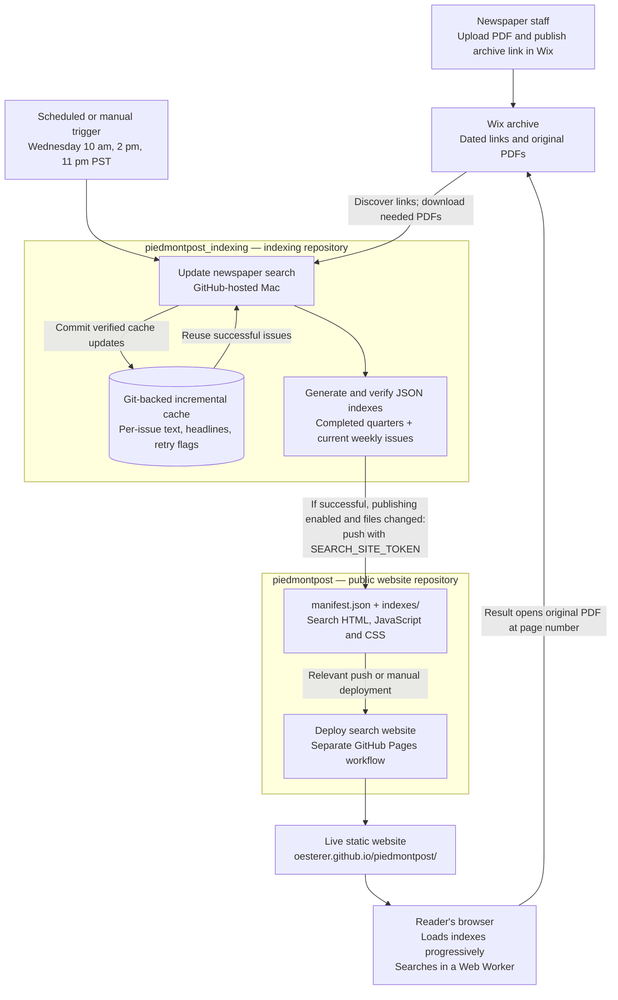
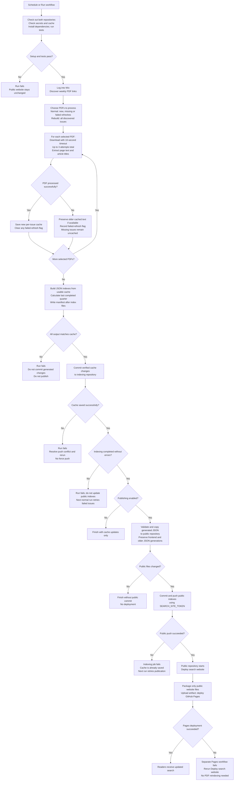

# Automated newspaper indexing and publishing

The system has two independent GitHub Actions workflows. PDF processing runs in `piedmontpost_indexing`; deployment runs in `piedmontpost`. Readers search static files in their browser.

## System overview

The schedule uses **fixed PST (UTC−8)**, not automatic daylight-saving adjustment. During PDT the same runs fall at Wednesday 11 am, Wednesday 3 pm, and Thursday midnight. GitHub may delay scheduled jobs. Publishing a Wix update does not directly trigger indexing; the next scheduled check or a manual run discovers it.

## Indexing workflow and failure paths

Exceptional discovery, extraction, or generation failures stop the relevant stage. Verification cannot make a failed indexing step publish: publication additionally requires indexing success. Copy/validation failures also stop publication before a public push.

## Repository ownership and credentials

| Component | Owner / location | Purpose |
|---|---|---|
| PDFs and archive links | Wix | Staff publishing and original documents |
| Indexing scripts and tests | `piedmontpost_indexing` | Discovery, extraction, grouping and validation |
| Incremental cache | `piedmontpost_indexing/cache/` | Avoid repeat processing and remember failed refreshes |
| Generated output | Ignored `piedmontpost_indexing/output/` | Temporary publication data |
| Public search files | `piedmontpost` root | Browser search, manifest and JSON indexes |
| Archive password | Indexer secret `PIEDMONT_ARCHIVE_PASSWORD` | Automated Wix login |
| Cross-repository token | Indexer secret `SEARCH_SITE_TOKEN` | Read/write public repository contents and trigger its push workflow |
| Private cache push | Built-in indexing workflow `GITHUB_TOKEN` | Commit cache without triggering another indexing job |
| Pages deployment | Public workflow's GitHub token and OIDC | Publish static website; no external host credentials |

Only one indexing job runs at a time. A separate concurrency group serializes Pages deployments. Successful private cache commits do not start another indexing run. Public pushes made with `SEARCH_SITE_TOKEN` trigger Pages normally.

The quarter cutoff is computed in **America/Los_Angeles**: during Q4 2026 it is September 30; from January 1, 2027 it becomes December 31. This calendar calculation is separate from the fixed-PST cron schedule. Quarter consolidation can change the public files even when no new PDF was added.

The browser initially loads the manifest and latest index, fetches older indexes as needed, and pauses after each batch of results. Full-text matching runs client-side. PDF links include `?page=N#page=N`; actual page navigation depends on the PDF viewer.

Source workflows: [indexing](.github/workflows/update-search.yml) and `../piedmontpost/.github/workflows/deploy-pages.yml`. Operational setup and recovery: [AUTOMATION.md](AUTOMATION.md).
